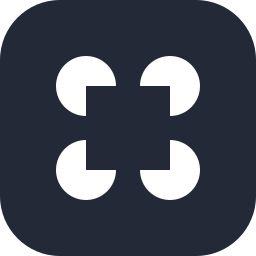
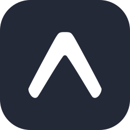
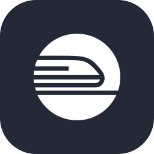

# Miguel Broedel

**Backend engineer for fintech and AI.** 
I build products end to end: the backend, the AI agents, and the frontend around them.

  

---

Self-taught since 14, now 18, based in Sorocaba, Brazil. Applying to Computer Science for 2027, and **open to internships and junior roles**.

## Selected work

<table>
<tr>
<td width="50%" valign="top">
<h3><a href="https://github.com/MigsBroedel/RSSBack">RSSBack</a></h3>

A personalized feed aggregator. Pluggable ingestion for RSS, HTML and YouTube, run by background workers.

  

</td>
<td width="50%" valign="top">
<h3><a href="https://github.com/MigsBroedel/AI-agenda">AI-agenda</a></h3>

A conversational Google Calendar agent. A LangGraph ReAct agent that creates and queries events in plain language.

 

</td>
</tr>
<tr>
<td width="50%" valign="top">
<h3><a href="https://github.com/MigsBroedel/Chip-8_Emulator">Chip-8_Emulator</a></h3>

A CHIP-8 emulator written from scratch: fetch, decode, execute. Runs Tetris and Pong.

</td>
<td width="50%" valign="top">
<h3><a href="https://github.com/MigsBroedel/Chess-Engine">Chess-Engine</a></h3>

Chess in Python with pygame: the board, the pieces and the rules of the game.

</td>
</tr>
</table>

## Stack

  <b>LANGUAGES</b> 
  
  
  
  
  

  <b>AI AND AGENTS</b> 
  
  
  
  

  <b>BACKEND AND DATA</b> 
  
  
  
  
  

  <b>FRONTEND AND MOBILE</b> 
  
  
  
  

  <b>INFRA</b> 
  
  
  
  
  
  

---

Reach me at <a href="mailto:miguel.broedel09@gmail.com">miguel.broedel09@gmail.com</a>

